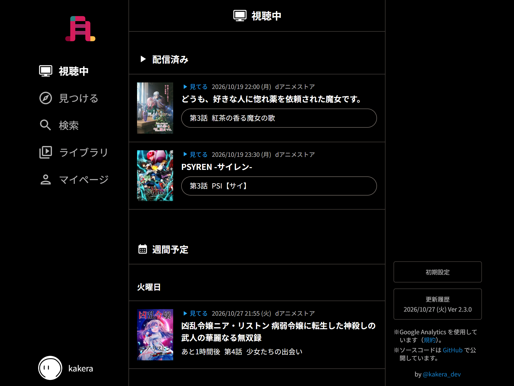
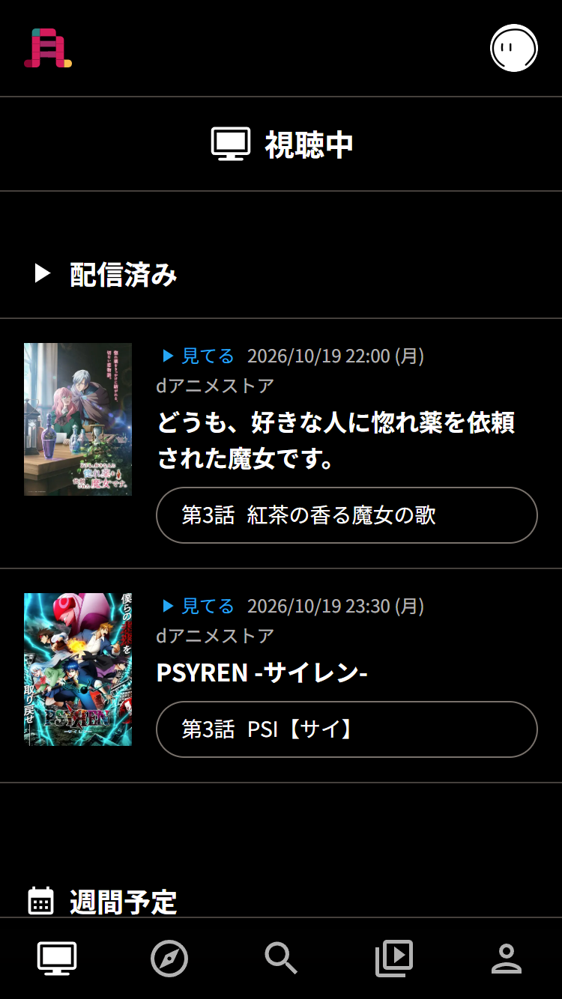
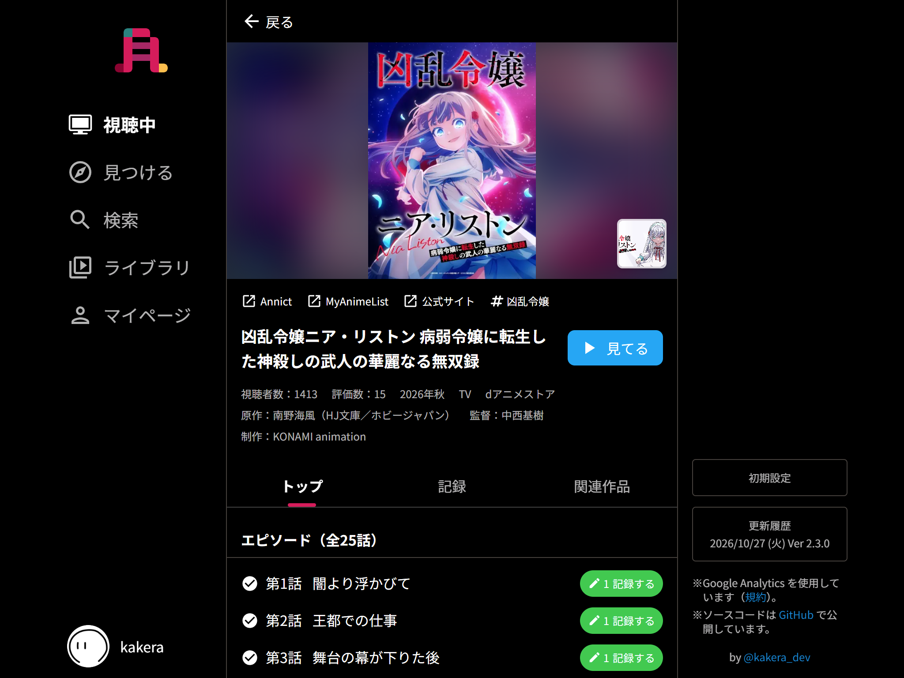
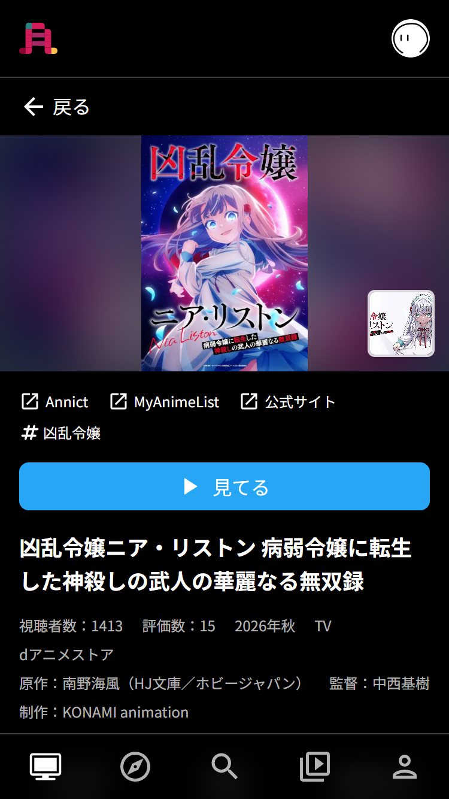
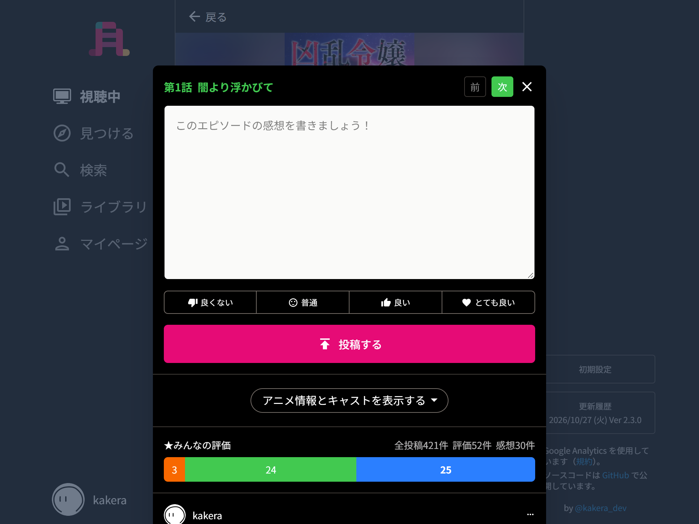
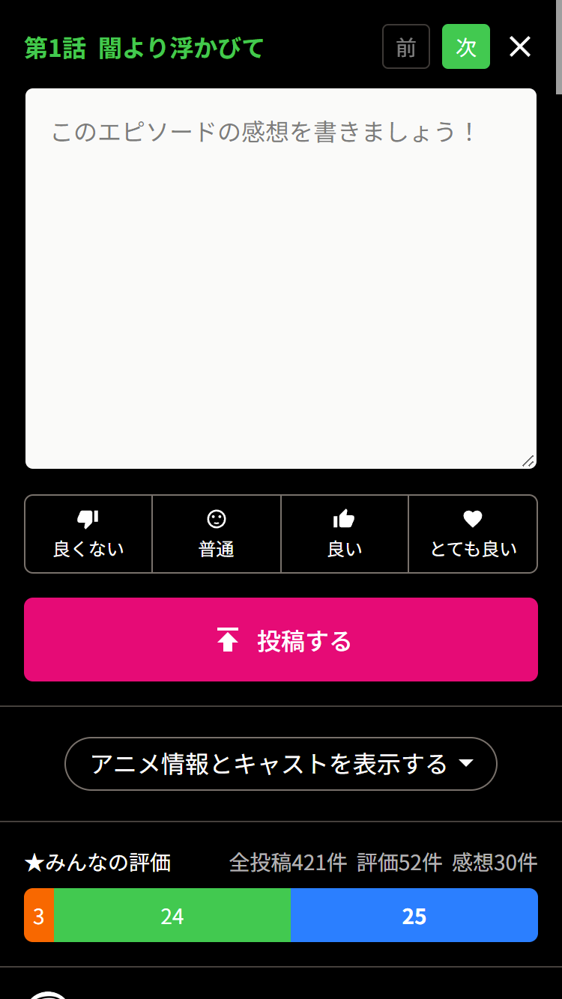
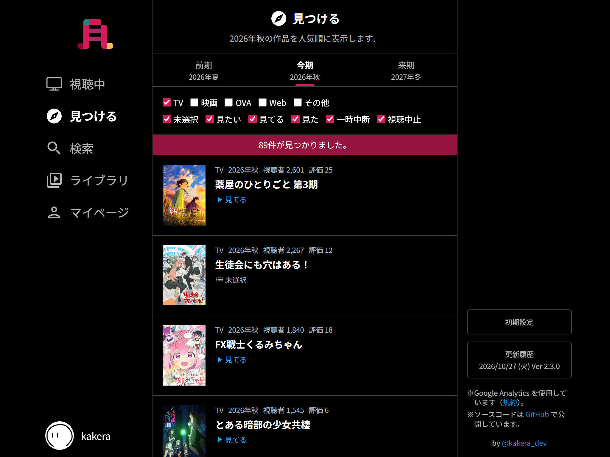
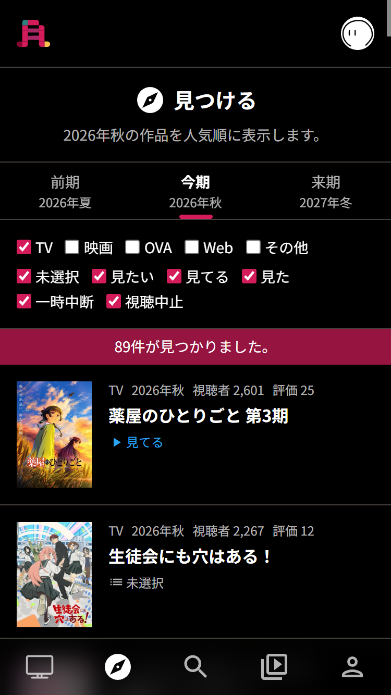
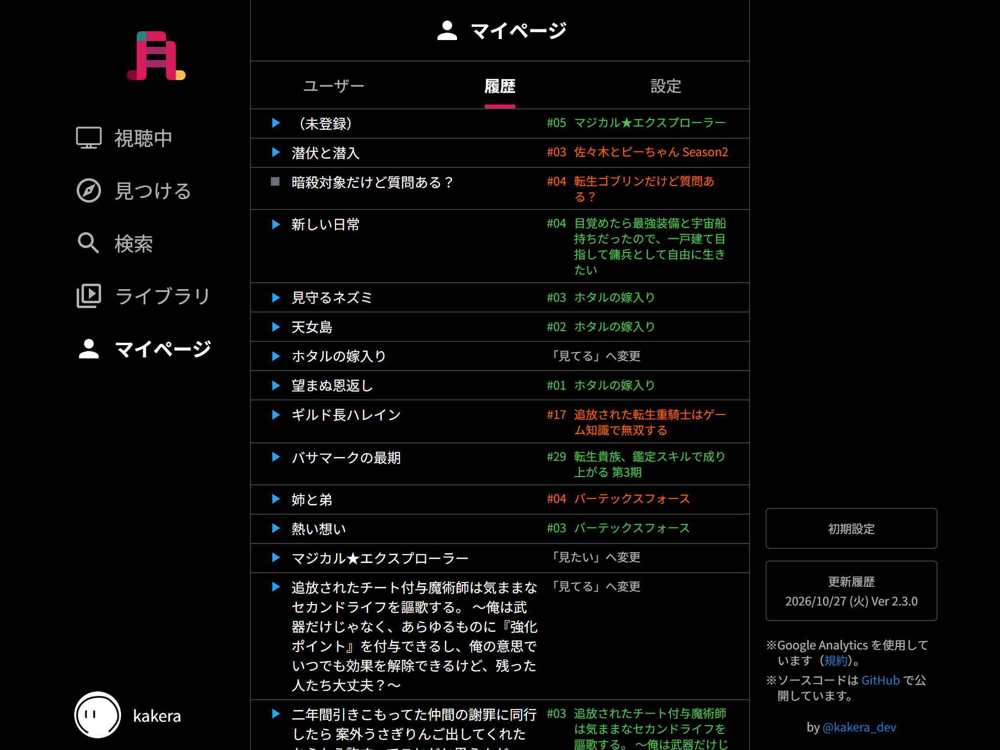
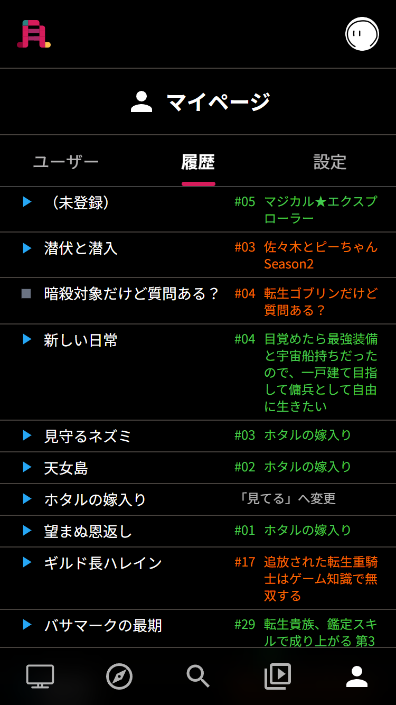

# アニみた

## ロゴ
Annict のロゴの「A」と漢字の「見」を掛け合わせたデザインにしました。

## 紹介
主に「配信サイト勢向け」に今すぐ見れるアニメと週間予定を分かりやすく提供し、感想を書く一助になれば！と思い開発しました。  
PWA に対応しており、スマホアプリのように使うことができます。  
データ取得には Annict の GraphQL API を使っています。  
ユーザー認証は OAuth を使っています。  
画像は MyAnimeList API とアニメ公式サイトの OGP を利用させていただいております。

## 以下のことができます
- アニメの視聴ステータスを変更
- アニメへの記録とエピソード毎の記録（コメント、評価、変更、削除）
- アニメごとに付けられている他のユーザーの記録の閲覧
- みんなの評価を集計し表示
- 季節ごとのアニメを検索
- アニメタイトルで検索
- 履歴などのマイページの提供

## TODO
- 他の人のエピソードの記録に対して、いいねを押したい（現状 API がないので断念中 >_<）

## スクリーンショット
### 視聴中

### 視聴中（スマホ）

### アニメ詳細

### アニメ詳細（スマホ）

### 記録する

### 記録する（スマホ）

### 見つける

### 見つける（スマホ）

### 履歴

### 履歴（スマホ）

